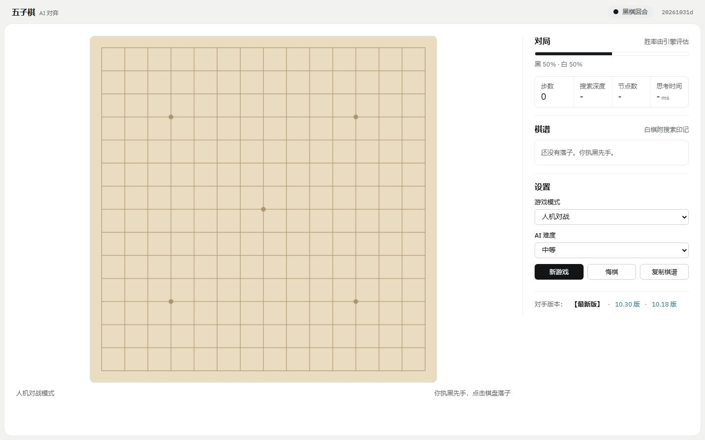

# 五子棋 AI（Gomoku AI）

[](https://github.com/han-yi794/gomoku/actions/workflows/ci.yml)

C++17 + WebAssembly 的五子棋（连五子）游戏：浏览器直接人机对战，核心是自研的 Alpha-Beta 搜索引擎。

**在线试玩：** https://han-yi794.github.io/gomoku/ —— 最新引擎；`/v1030/`、`/v1018/` 分别可试玩 10.30 与 10.18 的引擎，对比三个年代的棋力。



## 特性

- **C++17 核心引擎**：Alpha-Beta + 迭代加深 + 置换表（Zobrist 哈希）+ 增量棋型评估
- **VCF / VCT 战术搜索**：连续冲四（VCF）与「三」施压组合（VCT）的杀棋证明（见下文「AI 算法」）
- **「全证败」核实**：损失带结论必须由对手 VCF / VCT 杀核实，防「偶层视界假证败」；真败局面照实上报
- **败势拖延**：已必败时按将杀距离挑「拖得最久」的一手，而不是凭位置分随机挑一种死法
- **诚实评分**：棋谱与胜率条显示「所选着法的原始搜索分」（显示与选择分离，战术加成不再粉饰显示）
- **四档难度**：简单 / 中等 / 困难（约 10 秒/步）/ 超长考（约 30 秒/步，关键局面更久）
- **棋谱与统计**：逐手搜索印记（深度 / 节点 / 用时 / 评分）、实时胜率条、一键复制导出；构建号与结果写入棋谱头，便于复盘归因
- **机机对战**、悔棋、暂停 / 调速；移动端可用；便携版为单文件、离线可玩

## 快速开始

### 直接试玩

在线地址见上；或克隆本仓库后直接双击 `docs/index.html`（便携引擎，WASM 内嵌，免服务器）。

### 从源码构建（修改引擎时）

> **克隆后可直接开发**：仓库已附带引擎构建产物（`build/`），克隆后无需安装 Emscripten 即可运行测试、打开开发版页面；只有改动 `src/` 引擎代码时才需要按下面步骤重新编译。

需要 [Emscripten](https://emscripten.org/)（emsdk）：

```powershell
.\build.ps1      # 编译到 build\gomoku.js + build\gomoku.wasm
.\package.ps1    # 生成 dist\ 便携版（单文件引擎，可直接双击 file:// 打开）
```

构建脚本优先使用环境变量 `EMSDK`，未设置时回退到常见路径 `D:\emsdk`；路径不同请先 `$env:EMSDK = '你的 emsdk 路径'`。

开发版页面（引用 `build/`）需要本地服务器（WASM 经 fetch 加载，`file://` 会被 CORS 拦）：

```powershell
python -m http.server 8080   # 访问 http://localhost:8080/index.html
```

### 测试

```powershell
node test_engine.js            # 引擎基础用例
node test_diagonal_defense.js  # 威胁防守 / 败局上报等 19 项行为回归（发布底线）
node test_loss_claims.js       # 「全证败」抽查回归：假证败必须被拒、真败必须保留
node test_session_state.js     # 会话隔离：新局 / 悔棋不得串搜索表
```

以上 4 套在每次 push / PR 时由 GitHub Actions 自动跑（`.github/workflows/ci.yml`，全部 exit 0 才算绿）。

### 多线程（原生 CLI）

浏览器 WASM 暂不支持多线程（GitHub Pages 无法设置 COOP/COEP、便携 `file://` 版亦无 SharedArrayBuffer），多线程研究在本机原生 CLI 上进行：

```powershell
# 首次：便携 MinGW-w64 解压到 D:\mingw（见 AGENTS.md），之后：
pwsh -ExecutionPolicy Bypass -File native\build_native.ps1

.\native\gomoku_cli.exe bench 1        # 单线程夹具基线（9/9 为准入）
.\native\gomoku_cli.exe bench 4        # 4 线程对照（不得劣于 bench 1）
.\native\gomoku_cli.exe nps 1 20000    # 节点吞吐
.\native\gomoku_cli.exe search 7,7 7,8 8,6 ...   # 任意局面搜索
```

架构为**保守 SMP**：线程 0（参照线程，独立 TT）结果与单线程逐位一致；辅助线程共享另一张 TT，其结论只有「严格更优」（分高 / 同分更深）才被采纳——并行结果构造性 ≥ 单线程。实测（本机 4 核，20s 档）：`bench 1` 与 `bench 4` 均 9/9；`game12-m13` 上辅助线程贡献过严格更优（合并信息 `merge=401`）。注意：4 线程跑满时代理进程本身也占核，每线程有效预算会缩水（计时边界型夹具如 `game11-m8` 可能掉一档深度，属已记录的持平局范畴）。

测试直接加载 `build\gomoku.js`，请先运行 `build.ps1`。

## 项目结构

```
src/                     引擎源码（engine.cpp / engine.h / main.cpp 为 Emscripten 绑定）
index.html               界面与前端逻辑（开发版，引用 build/）
build/                   引擎构建产物（随仓库提交，克隆后即可开发 / 测试；由 build.ps1 重建）
test_*.js                回归测试
build.ps1 / package.ps1  构建与打包脚本
fonts/                   自托管字体 IBM Plex Sans/Mono（OFL 1.1，见 fonts/OFL.txt）
docs/                    GitHub Pages 上线页（构建产物：页面 + 便携引擎 + v1030/v1018 版本页）
```

## 发布（GitHub Pages）

本仓库的 Pages 服务于 `main` 分支的 `docs/` 目录。发布流程：`.\package.ps1` 后把 `dist\` 内容同步到 `docs\`（含 `.nojekyll`）；构建号变化时同步更新 `docs\v1030|v1018\index.html` 的构建号后缀。提交推送即自动部署。

## AI 算法

### 搜索策略

- **Alpha-Beta 剪枝**：NegaMax 变体
- **迭代加深**：从深度 1 开始逐步加深
- **置换表**：1M entries，Zobrist 哈希
- **候选点过滤**：半径 2 邻居过滤
- **走法排序**：快速威胁评估排序
- **VCF 战术层**：根节点先做一次「连续冲四」专项搜索。进攻侧找到必胜就直接走（实测 2ms 出结果）；防守侧剔除「走完之后对手有短连冲四杀」的候选。只搜造四着法，分支极窄，同样时间能到十几手冲四的深度。
- **VCT 战术层**：连冲四找不到时，再查「三」施压型组合。攻方的强制手 = 四 + 造活四威胁的三；守方应手不是手写棋型，而是**按定义算出**「所有能让攻方下一手无法形成活四的空点」，攻方必须对每个应手都成立才算取胜。目前只用于进攻——实测把它直接用于防守剔除会在必败局面里删掉拖延着法，反而速败（见「后续优化计划」）。
- **「全证败」核实**：搜索给出「所有着法均已证败」结论时，对排名前几的候选做一次对手 VCF / VCT 核杀——只要有候选对手证不出杀，本轮损失结论不采信、保留上一轮结果。防的是「偶层视界把不输的局面崩进损失带」；真败局面会被对手杀核实，照常上报。
- **决赛候选应招复核**：VCF 防守过滤后根候选常只剩两三手，而位置类加成在这几手里会挑错（实测把必败的一手评成 +4600 万）。困难档会在这几手上各做一次「对手应招搜索」，取对手得分最低者——把时间花在最后一层深算上。
- **将杀距离评分**：终局分不是固定 ±1000 万，而是 ±(WIN_THRESHOLD-1-k*8)——赢得越快分越高、**输得越晚分越高**。已必败时按此挑「拖得最久」的一手（而不是凭位置分随机挑死法）。
- **战术搜索置换表**：威胁搜索的递归里同一局面会被不同走法顺序反复展开（三的应手分支尤其容易回到同一局面）。表项按单调性复用：已证必胜在手数够时成立、未证必胜在手数更少时成立。
- **VCT 应手集合**：后手的造四着法不是一票否决，而是纳入「必须被检查的应手」——这正是深链杀法能被证出的关键（去掉一票否决后搜索空间扩大 150 倍，配合置换表 0.9s 内证出 10 层以上的杀）。
- **显示与选择分离**：选择仍用含战术加成的分值，但对外上报「所选着法的原始搜索分」——防止数千万级加成把败局显示成「大优」（实测出现过 +1011.7 万的假胜率）。

### 评估函数

- **棋型评分**：活四、冲四、活三、眠三等
- **攻防权重**：对手威胁 × 1.10（略偏防守）
- **中心加权**：位置离中心越近分越高
- **威胁检测**：连五、活四、冲四、活三

## 难度级别

| 难度 | 搜索深度 | 时间预算 | 适用场景 |
|------|----------|----------|----------|
| 简单 | 4 | 1000ms | 新手入门 |
| 中等 | 8 | 3000ms | 普通玩家 |
| 困难 | 16 | 20000ms | 老棋手（2026-11-14 定档：20s 起关键局面能「选对」；触发复核会更久） |
| 超长考 | 16 | 30000ms | 研究 / 实验档：实测能在中盘看清 10s 档完全看不到的败势（2026-11-14 第 12 局复核） |

## API 参考

### 游戏控制

| 函数 | 说明 |
|------|------|
| `initGame()` | 初始化新游戏 |
| `setDifficultyLevel(level)` | 设置难度 (0=简单, 1=中等, 2=困难, 3=超长考) |
| `playerMove(x, y)` | 玩家落子 |
| `aiMove()` | AI 思考并落子 |
| `undo()` | 悔棋一步 |
| `undoN(n)` | 悔棋 n 步 |

### 状态查询

| 函数 | 说明 |
|------|------|
| `getBoardSize()` | 获取棋盘大小 |
| `getCurrentPlayer()` | 获取当前玩家 (1=黑, 2=白) |
| `getMoveCount()` | 获取已落子数 |
| `getGameStatus()` | 获取游戏状态 (0=进行中, 1=黑胜, 2=白胜, 3=平局) |
| `getCell(x, y)` | 获取指定位置的值 |
| `getBoardData(buffer)` | 获取完整棋盘数据 |

### 搜索统计

| 函数 | 说明 |
|------|------|
| `wasmGetLastSearchDepth()` | 获取最后搜索深度 |
| `wasmGetLastSearchNodes()` | 获取最后搜索节点数 |
| `wasmGetLastSearchTimeMs()` | 获取最后搜索耗时 (ms) |
| `wasmGetLastSearchScore()` | 获取最后搜索的根节点评分（走子方视角的原始终局分）；落在 `[-(WIN_THRESHOLD+999), -(WIN_THRESHOLD-999)]` 区间表示「所有着法均已证败」（该结论只在候选完整扫描后成立） |
| `wasmHasVcfWin()` | 当前局面轮走方是否存在「连续冲四」（VCF）必胜，供自检 / 分析使用 |

## 性能

- **WASM 大小**：~51KB
- **JS 加载器**：~12KB（开发版）；单文件分发版 ~65KB（WASM 已内嵌）
- **中等难度**：~30 万节点/步，~3 秒/步
- **困难难度**：40 万~100 万+ 节点/步，~5–10 秒/步（触发决胜候选复核时更久）

## 后续优化计划

- [x] VCF 战术搜索（连冲四杀检测）
- [x] VCT 战术搜索（含活三的连续威胁，进攻侧）
- [x] 「全证败」抽查重新入库（2026-11-13）：两个历史「中盘让步」局面经审计确为真败（探针 + 深搜双确认）。当初误否决的病根是探针搜索的节点计数器未清零——累计计数超上限后搜索「零节点即判超时」空转，把真败误判成「对手证不出杀」。修复后 19 项行为回归 + 抽查测试全绿（test_loss_claims.js）
- [x] 首层耗时修复：首层迭代的耗时曾把「搜索开始至今的全部耗时」算在内，任何搜索前阶段变慢都会误触「提前收手」把搜索砍到深度 1（在抽查 / 防守阶段变重时实测触发）
- [x] 败势拖延强化：全证败时按将杀距离原始分取最大（拖得最久），不再走「按位置加成评选」
- [x] 超长考档（30s，2026-11-14）：第 12 局诊断显示 10s（深度 8-9）报「-592 还好」，30s（深度 10-12）看到 -370 万并改走正确方向——深度是这类中盘盲区的决定性变量
- [x] 困难档定档 20s（2026-11-14 实验）：15/20/25s 复跑第 12 局关键点——20s（深度 10）起把「会输的堵点」改成正确一手（决策改变点）；25s+ 才能如实上报败局。困难 10s→20s，30s 留给超长考
- [x] 选定手核杀保护（2026-11-14）：收尾时对最终选定的手做一次对手 VCF/VCT 核杀，被证杀且存在幸存候选时换成评分序最靠前的幸存者（预算 ≥8s 才启用，低耗档不受影响）。修复实测：20s 档 n15 曾选「自评 +366 万、实为 1.7s 被杀」的手，保护后自动换到幸存手 (5,10)；第 13 局 m12（黑方 43ms 证杀）同类问题随之封堵
- [x] b1 完整形态：根节点 VCT 剔除 + 杀距比较（2026-11-18）：VCF 过滤后**只对 VCF 幸存候选**补 VCT 核杀（「三」施压型连续威胁——VCF 证明不了、深搜容易看漏的深链杀）；节点上限 30 万/候选（原 60 万实测把 game12-m13 主搜索从深度 10 压到 9 且零收获）、合计硬顶 45% 预算、预算 <4s 跳过。**全部候选被证杀时不删候选**（败势里删掉的可能就是拖得最久的着法），杀距记入 killDist，全证败分支按「未被证杀(0) > 杀距更晚 > 深搜将杀 raw」挑拖延手。杀距为 mate 败带分（k=ply；设计借鉴 Rapfi 的 mate-in-value：距离编码进分值、比较即分值比较）。实测：4 套测试 + 夹具 8/9 全绿（game11-m8 为已知深度 10 持平抖动）；diagonal game2 认输着法 (9,4)→(5,8)（防守探针紧界 11 vs 9 ply 支持新选；黑方攻击层先证链 6 vs 7 四支持旧选——证据矛盾但两手均速败，差 ≤2 ply）
- [x] 战术搜索置换表（VCT 同类局面复用结论，双三证明 17ms -> 6ms）
- [x] VCT 剪枝精度：去掉「后手能造四就一律否决」的一票否决，改为把后手的造四着法纳入必须检查的应手集合（是否真能否决交给递归）。该局面搜索空间随之扩大 150 倍，配合置换表可在 0.9s 内证出全宽搜索够不到的深链杀
- [x] 根节点战术加成限幅（MAX_TACTICAL_ADJUST = 1000 万）：未限幅时实测出现 +4800 万幽灵评分（2026-10-31 对局白6），会盖过搜索结论代替决策；限幅后同一着法评分归位 +873 万
- [x] 会话状态清理：initGame / undo / undoN 清空主置换表与威胁搜索置换表。此前置换表从不清理，实测同一进程里玩过一盘后，同一开局 (7,7) 的应手从 (6,6) 漂移为 (8,6)/(8,8)（并列分被残留条目打破）。修复后新开一局回到干净状态，悔棋重下稳定可复现（回归：test_session_state.js）
- [x] 棋谱导出增强：头注明构建号与胜负结果，AI 每手附 [深度/节点/用时/评分]，悔棋等会话事件标在对应手前（便于复盘时精确归因到版本与状态）
- [x] 提前收手（省掉注定被丢弃的收尾层）：迭代加深的层间耗时实测增长 5~8 倍，剩余预算不足 2 倍本层耗时时直接结束。不改变已采纳结论
- [x] 增量棋型评估（单线程热路径提速）：每个节点只算一次基准棋型分（双色单遍扫描），候选只修正穿过落子点的四条线上的「跑」；与全盘扫描逐位一致（36,072 次随机差分对照 0 失配）。实测节点吞吐 ≈8–10×
- [x] 开局审计与预算校准（2026-10-31 对局）：白 4 的 (8,7) 被黑方深搜证明差 ~130 万——为 5s 预算下的部分迭代采纳所致；预算校准到 10s 后该位置恢复正确着法 (9,5)。部分迭代「超时全弃」闸门实验反而更差，已回退
- [x] 将杀距离评分（必败局面优先挑输得最慢的一手）
- [x] 决赛候选的「对手应招复核」：触发条件 = 局分未定 + 候选数少（≤5）+ 预算足够（≥4s）；对决赛候选逐个做对手应招搜索、取对手得分最低者。实测：某必败局面（候选 3 手）从错误着法改为正确防守 (4,8)。注意：威胁搜索不够用——「铺垫手 + 冲四链」型的败法它看不见
- [ ] 继续留意中盘越界评分：历史上个别搜索出现 ±5 千万级分数（超出 WIN_THRESHOLD 编码区间）；已限幅 + 显示分离处理了已知来源，尚未再见到新例
- [ ] NNUE 神经网络评估
- [ ] 多线程搜索（WASM SharedArrayBuffer）
- [ ] 开局书（Opening Book）
- [ ] 棋型模式库优化
- [ ] 移动端适配

## 许可证

- 本项目源代码：**Apache License 2.0**，Copyright 2026 han-yi794（见 [LICENSE](LICENSE)）
- 字体：[IBM Plex Sans / Mono](https://github.com/IBM/plex)，SIL Open Font License 1.1（见 fonts/OFL.txt）
- 构建工具链：[Emscripten](https://emscripten.org/)（MIT / University of Illinois）
